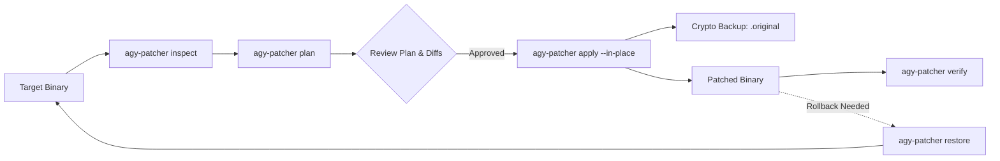

# AGY Suite — Administrator & User Guide

**Version:** 1.0.0  
**Target Systems:** Windows (x64), Linux (x64 MUSL)  
**Binaries:** `agy-patcher`, `agy-agent`

---

## 1. Executive Architecture & Overview

The **AGY Suite** is an enterprise-grade engineering toolkit split cleanly into two independent, purpose-built Rust binaries:

```
                                  +-----------------------+
                                  |      AGY SUITE        |
                                  +-----------+-----------+
                                              |
                   +--------------------------+--------------------------+
                   |                                                     |
        +----------v-----------+                              +----------v-----------+
        |     agy-patcher      |                              |      agy-agent       |
        +----------+-----------+                              +----------+-----------+
                   |                                                     |
        - 104 Rule Engine                                      - Autonomous ReAct Loop
        - AST/Pattern Patching                                 - 16-Dimension Policies
        - Cryptographic Backups                                - 6 Security Presets
        - Atomic Revert/Rollback                               - Tamper-Evident Audit
        - Workspace Neutral                                    - Zero-Bypass Boundaries
```

### Core Invariants & Boundaries
1. **Separation of Concerns:** `agy-patcher` modifies target codebases deterministically via regex/AST transforms without model hallucination. `agy-agent` acts as an autonomous pairing/coding agent governed by rigorous runtime permission policies.
2. **Preset Definition:** Presets (`Heretic`, `Uncensored`, `Unrestricted`, `Aggressive`, `Abliterated`, `Unleashed`) are **runtime behavioral and authorization profiles**. They configure autonomy, prompt friction, tool permissions, and step budgets—they never alter underlying model weights.
3. **Non-Bypassable Boundaries:**
   - **Provider Policy:** Model APIs cannot bypass server-side terms or controls.
   - **Operating System ACLs:** OS file permissions and user privileges are strictly respected.
   - **Explicit Deny Rules:** Hard-coded blacklists (`rm -rf /`, `del /f /s /q C:\Windows`, format commands, secret exfiltration) always supersede user prompts.
   - **Secrets Protection:** High-entropy API keys (`AKIA...`, `sk-...`, `ghp_...`) and credentials are auto-redacted in stdout and audit logs.
   - **Sandbox Root Confinement:** File writes and edits cannot escape the target workspace root directory.
   - **Always-on Audit:** Every tool invocation, shell execution, and patch operation is written to an append-only `.agy/audit.jsonl` log.

---

## 2. Installation & Verification

### 2.1 Automated Single-Line Installers

#### Linux (Universal: Ubuntu, Debian, RHEL, CentOS, Fedora, Alpine):
```bash
curl -fsSL https://raw.githubusercontent.com/simhaonline/agy-agent/main/install.sh | bash
```

#### Windows 10 / 11 / Server (PowerShell):
```powershell
irm https://raw.githubusercontent.com/simhaonline/agy-agent/main/install.ps1 | iex
```

---

### 2.2 Pre-Compiled Distributions

Pre-compiled, standalone binaries are located in the `dist/` directory:

| Platform | Target Architecture | Binary Name | Linking | Path |
| :--- | :--- | :--- | :--- | :--- |
| **Windows** | x86_64 (64-bit) | `agy-patcher.exe`<br>`agy-agent.exe` | Dynamic MinGW-w64 | [`dist/windows-x64/`](dist/windows-x64/) |
| **Linux** | x86_64 (64-bit) | `agy-patcher`<br>`agy-agent` | **Static MUSL** (Zero runtime deps) | [`dist/linux-x64/`](dist/linux-x64/) |
| **Linux** | i686 / x86 (32-bit) | `agy-patcher`<br>`agy-agent` | **Static MUSL** (Zero runtime deps) | [`dist/linux-x86/`](dist/linux-x86/) |

> [!NOTE]
> Linux x64 and x86 binaries are built with static MUSL linking (`-C target-feature=+crt-static`), making them 100% self-contained and portable across Ubuntu, Debian, RedHat/CentOS, Fedora, Rocky, Alpine, and Docker scratch containers without needing glibc upgrades or system runtime libraries.
> 
> *Windows 32-bit (x86):* Modern Windows developer hosts and enterprise deployments standardize on 64-bit (`x86_64-pc-windows-gnu` / `msvc`). If targeting legacy 32-bit Windows, compile using an MSVC 32-bit or multilib 32-bit MinGW toolchain.

### 2.2 Windows Installation

1. Copy the binaries to a system utility directory (e.g., `C:\Program Files\AGY\` or `C:\tools\agy\`):
   ```powershell
   New-Item -ItemType Directory -Force -Path "C:\tools\agy"
   Copy-Item "dist\windows-x64\agy-patcher.exe" "C:\tools\agy\"
   Copy-Item "dist\windows-x64\agy-agent.exe" "C:\tools\agy\"
   ```
2. Add the directory to your system `PATH`:
   ```powershell
   [Environment]::SetEnvironmentVariable("Path", $env:Path + ";C:\tools\agy", [EnvironmentVariableTarget]::Machine)
   ```
3. Verify the installation:
   ```powershell
   agy-patcher --version
   agy-agent --version
   ```

### 2.3 Linux Installation

1. Copy the binaries to `/usr/local/bin` and set executable permissions:
   ```bash
   sudo cp dist/linux-x64/agy-patcher /usr/local/bin/
   sudo cp dist/linux-x64/agy-agent /usr/local/bin/
   sudo chmod 755 /usr/local/bin/agy-patcher /usr/local/bin/agy-agent
   ```
2. Verify the installation:
   ```bash
   agy-patcher --version
   agy-agent --version
   ```

---

## 3. User Guide: Daily Workflows

### 3.1 Binary Patcher (`agy-patcher`)

`agy-patcher` provides deterministic, verified inspection and binary patching against 104 curated rules, applying modifications atomically with cryptographic backups, verified staging, and crash-safe rollbacks.



#### Workflow Steps:

1. **Inspect Binary PE Structure & Hashes:**
   Inspect binary sections, PE headers, checksums, and profile compatibility:
   ```bash
   agy-patcher inspect /path/to/target.exe
   ```
   *Output shows architecture (PE32/PE32+), SHA-256 hash, section headers, and size.*

2. **Generate Dry-Run Patch Plan:**
   Generate a non-destructive patch plan detailing matches, byte offsets, diffs, and shadow warnings:
   ```bash
   agy-patcher plan /path/to/target.exe
   ```

3. **Apply Patches with Verified In-Place Backup:**
   Apply approved plan atomically. Creates a verified baseline backup at `/path/to/target.exe.original`:
   ```bash
   agy-patcher apply /path/to/target.exe --in-place
   ```

4. **Verify Output Integrity:**
   Ensure patched binary matches expected hash or plan signatures:
   ```bash
   agy-patcher verify /path/to/target.exe
   ```

5. **Crash-Safe Restore / Rollback:**
   Instantly revert to the verified baseline original backup:
   ```bash
   agy-patcher restore /path/to/target.exe
   ```

6. **Automated Release Workflow:**
   Execute end-to-end safe download, extraction, inspection, and patching:
   ```bash
   agy-patcher auto --release-url <URL>
   ```

---

### 3.2 Autonomous AI Agent (`agy-agent`)

`agy-agent` provides autonomous and interactive reasoning over software projects. It executes actions through tool calling strictly within designated preset policy boundaries.

#### Workflow Steps:

1. **Interactive Chat Session:**
   Launch a stateful interactive terminal session:
   ```bash
   agy-agent chat
   ```
   With a custom preset or model:
   ```bash
   agy-agent chat --preset heretic --model gpt-4o
   ```

2. **Autonomous Goal Execution:**
   Execute a single autonomous objective end-to-end:
   ```bash
   agy-agent run "Audit the authentication middleware and refactor token refresh logic"
   ```
   Run with specific preset permissions:
   ```bash
   agy-agent run --preset unrestricted "Analyze dependencies in Cargo.lock and list vulnerabilities"
   ```

3. **Inspect Presets & Effective Policy:**
   List all available behavior presets and inspect their policy rules:
   ```bash
   agy-agent preset list
   agy-agent preset show unleashed
   ```

4. **Inspect Built-in Tool Registry:**
   List all native tools and their active permission boundaries:
   ```bash
   agy-agent tools
   ```
   *Tools include: `read_file`, `write_file`, `edit_file`, `list_directory`, `run_command`, `git_status`, `git_diff`, `git_commit`, `http_request`, `search_files`.*

5. **Inspect Sessions:**
   List past interactive and autonomous sessions:
   ```bash
   agy-agent sessions list
   agy-agent sessions show <SESSION-ID>
   ```

6. **System Diagnostics & Environment Doctor:**
   Run diagnostics on environment, API connectivity, toolchain, and permissions:
   ```bash
   agy-agent doctor
   ```

7. **Validate Workspace Configuration:**
   Verify `.agy/config.json` syntax and policy constraints:
   ```bash
   agy-agent config validate
   ```

8. **Monitor Live Audit Logs:**
   Stream or inspect audit events:
   ```bash
   agy-agent audit --limit 20
   ```

9. **Multi-Account Switching, Auth & Quota Engine (`account` & `auth`):**
   Register and toggle accounts with automated 429 cooldown failover, dynamic health ranking, pre-switch backups, and CLI/Desktop synchronization (inspired by `agy-switch`, `fikrilal/agy-auth`, and `zcop/agy-cli-manager`):
   ```bash
   # Add profiles with tier and email metadata
   agy-agent account add --name "Claude-Work" --provider "claude" --key "sk-ant-..." --model "claude-3-5-sonnet" --quota 250000 --tier "Enterprise" --email "team@corp.com"
   agy-agent account add --name "OpenAI-Backup" --provider "openai" --key "sk-proj-..." --model "gpt-4o" --tier "Pro"

   # List accounts with health ranking scores
   agy-agent auth list
   agy-agent auth rank

   # Switch active account with automatic pre-switch backup
   agy-agent auth switch Claude-Work --target both

   # Quota-aware automatic pool rotation
   agy-agent auth rotate --threshold 90.0

   # Capture live CLI token or synchronize with CLI
   agy-agent auth capture --name "Google-Work"
   agy-agent auth sync

   # Snapshot export and backup restoration
   agy-agent auth export --output .agy/profiles_bundle.json
   agy-agent auth backups
   ```

10. **Universal Local API Gateway Server (`serve`):**
    Expose standard OpenAI, Claude, and Gemini API endpoints for local IDE extensions (Cursor, Cline, Continue, Aider):
    ```bash
    agy-agent serve --port 8080 --host 127.0.0.1
    ```
    Configure your IDE tool with:
    - **Base URL:** `http://127.0.0.1:8080/v1`
    - **API Key:** `any-key` (or managed by active account)
    - **Model:** `gpt-4o` or `claude-3-5-sonnet`

11. **AI Staffer Delegation & Git Safety Guardrail (`staff`):**
    Deploy specialized companion roles for code exploration, review, and editing:
    ```bash
    # Q&A grounded in codebase
    agy-agent staff ask "How does the patch staging transaction work?"

    # Read-only architecture research
    agy-agent staff research "Examine all policy checks in agent runner"

    # Code review on current git diff
    agy-agent staff review

    # Code implementation with dirty-tree safety checks
    agy-agent staff implement "Implement exponential backoff"
    # (Refuses to clobber uncommitted files unless --force is provided)
    agy-agent staff implement "Quick fix" --force
    ```

12. **Host Client & Process Inspector (`client`):**
    Detect installed desktop/CLI clients, versions, running processes, and gateway telemetry:
    ```bash
    agy-agent client detect
    agy-agent client status
    ```

13. **Embedded Web UI/UX Dashboard (`dashboard` & `serve --open`):**
    Launch the full-featured, local browser dashboard for real-time monitoring and control:
    ```bash
    # Open dashboard directly in default web browser
    agy-agent dashboard

    # Run on custom port/host
    agy-agent dashboard --port 8080 --host 127.0.0.1

    # Start gateway with browser dashboard auto-launch
    agy-agent serve --open
    ```
    The Web UI/UX provides:
    - **Live System Cards:** Active model/provider display, request counts, errors, quota utilization %, and 429 cooling indicators.
    - **Multi-Account Manager:** Visual card deck of all registered providers. Switch active keys in 1 click, track token budgets with progress bars, and add new providers via modal dialog.
    - **Host Client Diagnostics:** Automatic detection of installed AGY/Antigravity host installations, executable paths, detected versions, running PIDs, and live port reachability.
    - **AI Staff Playground:** Interactive browser chat with companion role switcher (`Ask`, `Researcher`, `Reviewer`, `Implementer`) and security presets.
    - **Tamper-Evident Audit Feed:** Streaming event viewer of `.agy/audit.jsonl` with timestamped tool calls and automated credential redaction.
    - **Quick Connect Snippets:** One-click copy configs for Cursor, Cline, Continue, Aider, Python, and curl.

---

## 4. Behavior & Permission Presets Deep Dive

Presets determine tool availability, autonomy levels, loop budgets, and execution boundaries. They configure local client policies and permissions—**they do not alter model weights or bypass remote provider safety policies**.

### 4.1 The Six Named Presets

1. **`Heretic`**: Custom persona and instruction hierarchy; direct technical engineering tone; reduced stylistic friction.
2. **`Uncensored`**: Disables client-side keyword refusal layer; remote model provider terms and policies still apply.
3. **`Unrestricted`**: Broad filesystem, shell, and tool permissions inside configured sandbox root.
4. **`Aggressive`**: Autonomous multi-step planning, higher retry limits, subagent spawning, and expanded step budgets (100 steps / 200 tool calls).
5. **`Abliterated`**: Maximally permissive local policy profile (NOT weight abliteration); minimal approval prompts in sandbox.
6. **`Unleashed`**: Maximum autonomy, background tasks, persistent project sessions, and comprehensive tooling within non-bypassable boundaries.

### 4.2 16-Dimension Effective Policy Matrix

| Policy Dimension | `Heretic` | `Uncensored` | `Unrestricted` | `Aggressive` | `Abliterated` | `Unleashed` |
| :--- | :---: | :---: | :---: | :---: | :---: | :---: |
| **Persona Instructions** | Custom/Direct | Standard | Standard | Standard | Standard | Custom Allowed |
| **Client Refusal Layer** | Low | Disabled | Low | Low | Disabled | Disabled |
| **Planning Autonomy** | Medium | Medium | High | High | High | Full |
| **Tool Permissions** | Medium | Medium | High | High | High | Full in Sandbox |
| **Approval Threshold** | Standard | Standard | Reduced | Reduced | Reduced | Minimal |
| **Filesystem Scope** | Workspace | Workspace | Workspace + Approved | Workspace + Approved | Workspace + Approved | Workspace + Approved |
| **Shell Execution** | Approved | Approved | Broad Allowlist | Broad Allowlist | Broad Allowlist | Broad Allowlist |
| **Network Egress** | Approved | Approved | Broad Egress | Broad Egress | Broad Egress | Broad Egress |
| **Browser Automation** | Optional | Optional | Optional | Optional | Optional | Optional |
| **Subagent Spawning** | Limited | Limited | Enabled | Enabled | Enabled | Enabled |
| **Background Tasks** | Off | Off | Optional | Optional | Optional | Enabled |
| **Memory Persistence**| Session | Session | Project | Project | Project | Project + BG |
| **Retries & Recovery**| Standard | Standard | High | High | High | High |
| **Telemetry** | Opt-in | Opt-in | Opt-in | Opt-in | Opt-in | Opt-in |
| **Audit Logging** | Always-on | Always-on | Always-on | Always-on | Always-on | Always-on |
| **Step / Call Budget**| 25 / 50 | 25 / 50 | 50 / 100 | 100 / 200 | 100 / 250 | 150 / 300 |

---

## 5. Administrator Guide: Governance, Security & Deployment

### 5.1 Central Configuration (`.agy/config.json`)

Administrators can enforce corporate model providers, timeouts, and default security presets by committing `.agy/config.json` at the workspace root or placing it in `/etc/agy/config.json` (Linux) / `%PROGRAMDATA%\agy\config.json` (Windows):

```json
{
  "version": 1,
  "default_preset": "unrestricted",
  "workspace_root": ".",
  "model_provider": {
    "provider": "openai",
    "base_url": "https://api.openai.com/v1",
    "api_key_env": "OPENAI_API_KEY",
    "default_model": "gpt-4o",
    "temperature": 0.2,
    "max_tokens": 4096,
    "timeout_seconds": 60
  },
  "rate_limiting": {
    "max_requests_per_minute": 60,
    "max_tokens_per_minute": 150000
  },
  "audit": {
    "enabled": true,
    "log_path": ".agy/audit.jsonl",
    "redact_secrets": true
  }
}
```

#### Self-Hosted / Local LLM Integration (Ollama / vLLM / LiteLLM):

For air-gapped or private enterprise environments, configure local endpoints:

```json
{
  "model_provider": {
    "provider": "ollama",
    "base_url": "http://localhost:11434/v1",
    "api_key_env": "OLLAMA_API_KEY",
    "default_model": "qwen2.5-coder:32b",
    "temperature": 0.0,
    "max_tokens": 8192,
    "timeout_seconds": 120
  }
}
```

### 5.2 Environment Variable Overrides

Administrators can override settings across environments using standard environment variables:

| Variable | Description | Example |
| :--- | :--- | :--- |
| `AGY_PRESET` | Override active security preset | `export AGY_PRESET=unrestricted` |
| `AGY_CONFIG_PATH` | Path to master configuration file | `export AGY_CONFIG_PATH=/etc/agy/config.json` |
| `AGY_AUDIT_LOG` | Path to enterprise audit log file | `export AGY_AUDIT_LOG=/var/log/agy/audit.jsonl` |
| `OPENAI_API_KEY` | Provider API key for OpenAI | `export OPENAI_API_KEY=sk-...` |
| `ANTHROPIC_API_KEY`| Provider API key for Anthropic | `export ANTHROPIC_API_KEY=sk-ant-...` |

---

### 5.3 Audit Log Schema & SIEM Integration

Every event written to `.agy/audit.jsonl` follows a strict schema structured for enterprise log aggregators (Splunk, Elastic, Datadog):

```json
{
  "timestamp": "2026-11-11T18:52:14.382Z",
  "session_id": "sess-4a8f9c1b",
  "preset": "unrestricted",
  "event_type": "tool_call",
  "tool_name": "run_command",
  "arguments": {
    "command": "cargo test --workspace"
  },
  "policy_evaluation": {
    "status": "APPROVED",
    "rule": "allowlist_build_tools",
    "reason": "cargo matches approved build runner"
  },
  "execution_duration_ms": 1420,
  "exit_code": 0
}
```

#### SIEM Forwarding via Fluentd / Filebeat:
Configure your log shipper to ingest `.agy/audit.jsonl` and alert on:
- `policy_evaluation.status == "DENIED"` (attempted sandbox bypass or blacklisted command)
- `tool_name == "run_command"` where command was prompted for user approval.

---

### 5.4 CI/CD Pipeline Integration

In CI/CD environments (GitHub Actions, GitLab CI, Jenkins), enforce reproducible workflows with automated diagnostics and audit logging:

```yaml
# Example GitHub Actions Workflow Step
name: Automated AGY Policy Check & Patch Verification
on: [pull_request]

jobs:
  agy-compliance:
    runs-on: ubuntu-latest
    steps:
      - uses: actions/checkout@v4

      - name: Install AGY Suite
        run: |
          curl -L https://internal-artifacts.corp/agy/linux-x64/agy-patcher -o /usr/local/bin/agy-patcher
          curl -L https://internal-artifacts.corp/agy/linux-x64/agy-agent -o /usr/local/bin/agy-agent
          chmod +x /usr/local/bin/agy-patcher /usr/local/bin/agy-agent

      - name: Verify Environment & Policy
        run: |
          agy-agent doctor
          agy-agent config validate

      - name: Run Repository Security Audit
        run: |
          agy-agent run --preset unrestricted "Scan repository for leaked credentials and deprecated dependencies"
```

---

## 6. Troubleshooting & Diagnostics

| Symptom / Error | Root Cause | Administrative Resolution |
| :--- | :--- | :--- |
| `SandboxViolation: path escapes workspace root` | An agent tool attempted to read or modify a file outside the working directory (e.g., `../../etc/passwd`). | Expected behavior. Ensure the task is constrained to the workspace or set `workspace_root` appropriately in `.agy/config.json`. |
| `PolicyDenied: command 'rm -rf' blocked by policy` | A dangerous command on the explicit deny list was invoked. | Overriding explicit deny rules is forbidden by non-bypassable boundaries. Use specific target cleanup paths. |
| `ProviderError: 401 Unauthorized` | Invalid or missing API key in environment. | Set `OPENAI_API_KEY` or `ANTHROPIC_API_KEY` in environment, or configure private endpoint in `.agy/config.json`. |
| `BackupNotFound: no backup found for session` | Attempted to run `agy-patcher revert` without a prior `agy-patcher apply` in this workspace. | Backups are generated in `.agy/backups/` during `apply`. Ensure `.agy/` directory is not deleted or in `.gitignore`. |
| `CompilationLinkerError` on Windows 32-bit | Attempting to link 32-bit binaries with 64-bit MinGW libraries. | Use the certified 64-bit Windows binary (`dist/windows-x64/`) or install multilib 32-bit MinGW toolchain. |

---

## 7. Support & Maintenance Lifecycle

- **Binary Updates:** Update binaries by swapping `agy-patcher` and `agy-agent` in `/usr/local/bin` or `C:\tools\agy\`.
- **Database Rules:** Rule updates do not require model retraining; rule updates are verified deterministically against AST signatures.
- **Audit Retention:** Enterprise compliance recommends retaining `.agy/audit.jsonl` logs for a minimum of 90 days.
